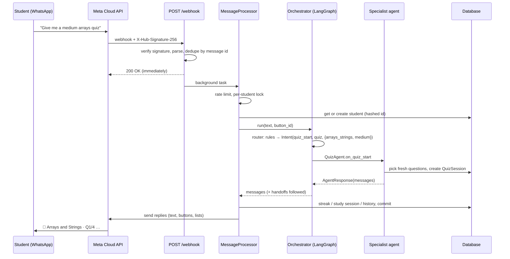
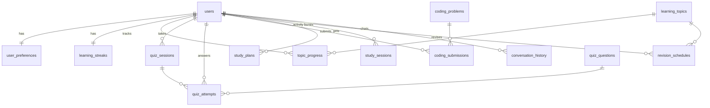

# Architecture

This document explains how a WhatsApp message becomes a lesson, a quiz answer or a progress report,
and why the code is organised the way it is.

## 1. Request lifecycle



Key points:
- **Fast acknowledgement.** Meta expects a quick 200, and slow LLM calls happen in a FastAPI background task.
- **Exactly-once processing.** Meta retries webhooks, so `Deduplicator` remembers message IDs for 48 h.
- **Per-student serialisation.** An `asyncio.Lock` per student means two quick messages can't corrupt
  that student's conversation state. Different students are processed concurrently.
- **One DB transaction per message.** Agents only stage changes, and the pipeline commits once at the end
  (or rolls back and sends a friendly error).

## 2. Multi-agent design

| # | Agent | File | Responsibilities |
|---|---|---|---|
| 1 | DSA Tutor | `agents/dsa_tutor.py` | DSA lessons, dry runs, complexity, practice problems, hints and solutions |
| 2 | C++ & Python Coding | `agents/coding_agent.py` | Language lessons; writing, debugging and reviewing code |
| 3 | ML Tutor | `agents/ml_tutor.py` | Maths, NumPy/Pandas, algorithms, deep learning and projects (10-point lesson format) |
| 4 | Quiz & Assessment | `agents/quiz_agent.py` | Quizzes, understanding checks, revision sessions, mock interviews |
| 5 | Progress Tracking | `agents/progress_agent.py` | Reports, weak/strong topics, streaks, "what next?" |
| 6 | Study Planner | `agents/planner_agent.py` | Daily plans, preferences, onboarding, reminder consent |
| 7 | Main Orchestrator | `agents/orchestrator.py` | Understands the request, routes, follows handoffs; also handles help, privacy and deletion |

Agents 1–3 share a `TutorAgent` base class (`agents/tutor.py`): track menus, lessons, "explain simpler" and Q&A
are the same behaviour with different prompts and tracks.

### The LangGraph graph

```
START → router ─┬─▶ dsa ───────┐
                ├─▶ coding ────┤
                ├─▶ ml ────────┤    handoff_pending? ── yes ─▶ (route to the next agent, max 3 hops)
                ├─▶ quiz ──────┤
                ├─▶ progress ──┤                     └─ no ──▶ END
                ├─▶ planner ───┤
                └─▶ general ───┘
```

- **router** calls `intents.classify()`: a deterministic rule engine for buttons, `/commands`,
  conversation modes (quiz in progress, interview, waiting for delete confirmation) and common phrasings.
  Only when a free-form question can't be placed does it ask the LLM to pick a track.
- **Handoffs**: an agent can return `AgentResponse(handoff=Intent(...))`. For example, when a student pastes code
  during practice, the DSA tutor hands it to the Coding agent along with the problem context.
- Non-serialisable dependencies (DB session, LLM client) travel in `config["configurable"]["ctx"]`,
  so the graph state stays a plain dict.

### Why rules first, LLM second?
Button taps and commands make up most WhatsApp traffic. Rules make them instant, free and predictable, and
easy to unit-test (see `tests/unit/test_intents.py`). The LLM is used for what it is good at: teaching,
open questions, grading free text, generating questions and reviewing code.

## 3. Data model



- `learning_topics`, `quiz_questions` (source `bank`) and `coding_problems` are shared content, seeded
  idempotently from `app/content/` at startup. AI-generated questions are stored with `source = "ai"`.
- Everything else belongs to one student, with `ON DELETE CASCADE`, so `/deletedata` removes it all
  (and `services/privacy.py` deletes explicitly too, for any database).
- `users.state` (JSON) holds conversation state: current mode, active quiz, current topic, onboarding step,
  and any pending lesson chunks for "more".

## 4. Learning logic

### Topic status
```
not_started ──(lesson opened or first answer)──▶ learning ──(≥3 answers & rolling accuracy ≥ 70%)──▶ completed
```
- **Mastery** is the accuracy of the last 10 answers on that topic.
- **Weak** means ≥3 answers with mastery < 60%. Weak topics are added to the revision schedule automatically.
- **Strong** means ≥5 answers with mastery ≥ 80%.

### Spaced repetition (`services/revision.py`)
A simplified SM-2. A revision session's accuracy becomes a quality score q = round(accuracy × 5).
q < 3 resets to tomorrow; otherwise intervals grow 1 → 3 → interval × ease, and ease adapts.

### Recommendations (`progress.recommend_next`)
1. A topic due for revision today
2. The weakest topic
3. A topic already in progress
4. The next topic in curriculum order whose prerequisites are done or in progress

### Streak and study time
- A day counts toward the streak only for learning actions (lessons, answers, practice), not for "hi".
  Days are computed in the student's timezone.
- Study time is *estimated* by grouping activity into sessions (gap > 15 min starts a new session) and is
  always labelled as an estimate.

## 5. WhatsApp formatting

- `whatsapp/formatter.py` converts LLM Markdown to WhatsApp syntax (`**x**` → `*x*`, headings → bold,
  removes code-fence language tags) and splits long text into ≤1500-character chunks. It never splits inside
  a code block without closing and reopening the fence.
- Lessons longer than `MAX_CHUNKS_PER_REPLY` messages are paginated: the student types **more**.
- `whatsapp/messages.py` enforces Cloud API limits (3 reply buttons, 20-char titles, 10 list rows …), so an
  agent can't build an invalid payload.
- Quiz options use list messages (4 options) or reply buttons (true/false). Each button ID encodes
  `qa:<session>:<question>:<option>`, so taps on old questions are detected.

## 6. Offline and failure behaviour

| Situation | Behaviour |
|---|---|
| No `OPENAI_API_KEY` | Curated lessons (10 flagship topics) or topic summaries, the full quiz bank, problems with reference solutions, self-assessment instead of AI review |
| LLM error or timeout | Falls back to the curated path for that request |
| Student exceeds daily AI budget | Same fallback, no further LLM calls until tomorrow |
| Unexpected exception | Transaction rolled back, friendly error message, stack trace logged |
| WhatsApp send fails (429/5xx) | Retried with exponential backoff (3 attempts) |
| Outside the 24 h service window | Approved template, or skipped if none is configured |
